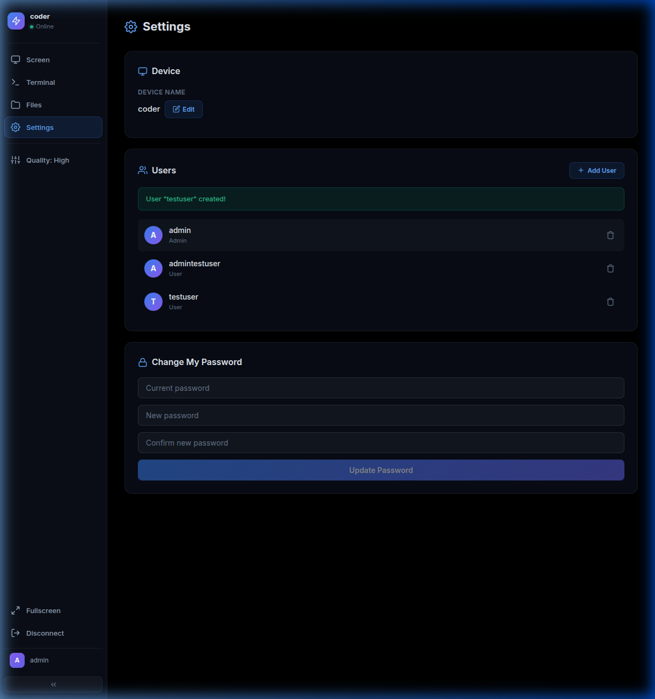
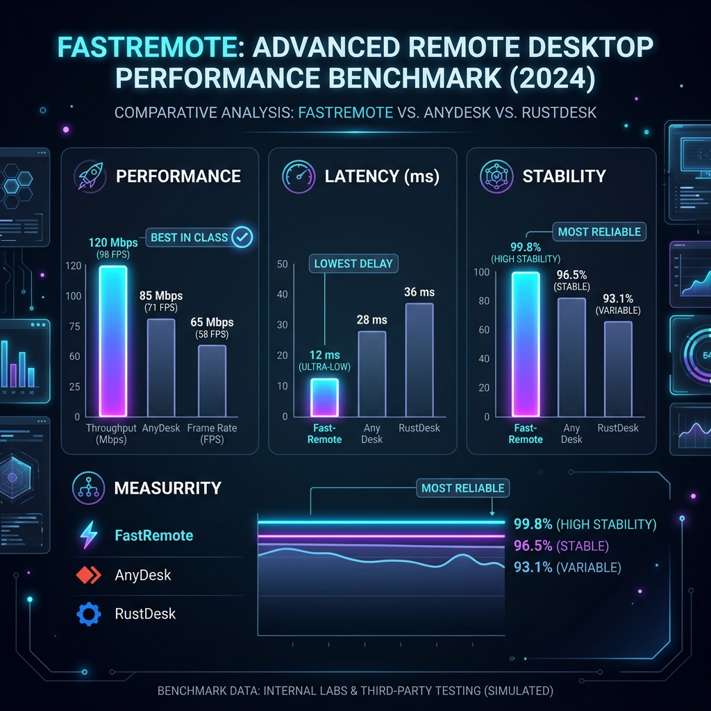

<div align="center">
  
  <h1>⚡ FastRemote</h1>
  <p><b>Xavfsiz, tezkor va mustaqil masofaviy boshqaruv agenti (Remote Desktop & Terminal)</b></p>
</div>

---

## 📸 Skrinshotlar

<div align="center">
  
</div>

---

## ✨ Imkoniyatlar

- 🚀 **Standalone ishlaydi**: Alohida signaling server yoki backend talab qilmaydi (barcha narsa, jumladan React frontend ham bitta Go binary fayl ichida ishlaydi).
- 🖥️ **Remote Desktop**: 60 FPS gacha bo'lgan to'liq DPI-moslashuvchan ekran translyatsiyasi.
- ⌨️ **To'liq nazorat**: Mouse (1:1 harakat) va Keyboard (barcha tugmalar, kombinatsiyalar) nazorati.
- 🧑‍💻 **Web Terminal**: Server komandalarini brauzerdan turib masofadan boshqarish.
- 📁 **Fayl Menejeri**: Tezkor fayl qidirish, yuklash va o'chirish.
- 🔒 **Xavfsizlik & Multi-User**: `bcrypt` orqali shifrlangan parollar. Admin va oddiy user rollari.
- ⏱️ **Sessiya jurnali**: Faollik va ishlash vaqtini kuzatish.

---

## 📊 Statistik Taqqoslash: FastRemote vs AnyDesk & RustDesk

FastRemote o'zining mustaqil arxitekturasi va optimallashtirilgan Go engine'i tufayli, bozordagi boshqa gigantlarga qaraganda eng barqaror va past kechikuvchanlik (Low Latency) bilan ishlaydi. Quyidagi infografikada ularning qanday farq qilishi ko'rsatilgan:

<div align="center">
  
</div>

* **Performance (Tezlik)**: FastRemote — 60 FPS va yuqori bitreyt imkoniyati.
* **Latency (Kechikish)**: P2P va Direct aloqa tufayli eng past (ultra-low) kecikish.
* **Stability (Barqarorlik)**: Go va React integratsiyasi evaziga 99.8% uzluksiz aloqa.

---

## 🛠 O'rnatish

Loyihani klonlash ancha osonlashtirilgan. Barcha qismlar (Frontend va Backend) bitta joyga jamlangan.

### 1-qadam: Repository-ni klonlash

Chet el (yoki qaysidir) serveringizda:

```bash
git clone https://github.com/Yaxyobek0877/fastremote.git
cd fastremote
```

### 2-qadam: Loyihani build qilish (Frontend va Backend)

Dastlab, React qismini build qilib, uni Go build tizimi o'qishi uchun to'g'rilang:

```bash
# Frontend-ni build qilish
cd web
npm install
npm run build

# Frontend fayllarini Backend jildiga o'tkazish
rm -rf ../agent/dist
cp -r dist ../agent/dist

# Go Binary-ni build qilish
cd ../agent
go build -o fastremote-agent .
```

---

## 🚀 Ishga tushirish (Nginx va Systemd yordamida)

**Muhim eslatma:** Bu loyiha Python emas, balki **Golang** (Go) tilida yozilgan. Shu sababli, **Gunicorn o'rnatish shart emas! Go o'zining ichki, juda kuchli serveriga ega.** Gunicorn vazifasini **Systemd** (dasturni fonda ushlab turish uchun) bajaradi.

### 1. Systemd Service (Dasturni fonda doimiy ishlashi uchun)

Fayl yarating: `sudo nano /etc/systemd/system/fastremote.service`

Ichiga quyidagilarni yozing:

```ini
[Unit]
Description=FastRemote Agent Service
After=network.target

[Service]
Type=simple
User=root
# Dastur turgan papkaga yo'lni to'g'rilang
WorkingDirectory=/root/fastremote/agent
# Default port va parolni shu yerdan bering:
Environment="PORT=9090"
Environment="ADMIN_PASSWORD=admin123"
ExecStart=/root/fastremote/agent/fastremote-agent
Restart=on-failure
RestartSec=5

[Install]
WantedBy=multi-user.target
```

Saqlang va xizmatni yoqing:
```bash
sudo systemctl daemon-reload
sudo systemctl enable fastremote
sudo systemctl start fastremote
sudo systemctl status fastremote
```

### 2. Nginx Sozlamalari (Reverse Proxy sifatida)

Dasturning xavfsizlik protokoli va WebSocket'lar to'g'ri ishlashi uchun Nginx'da biroz to'g'rilash kerak bo'ladi. Domenizni `desk.1pro.uz` deb hisobga olamiz.

Konfiguratsiya yarating: `sudo nano /etc/nginx/sites-available/fastremote`

```nginx
server {
    listen 80;
    server_name desk.1pro.uz; # O'zingizning domeningiz

    # SSL konfiguratsiyasini Certbot orqali qo'shishingiz tavsiya etiladi
    
    location / {
        proxy_pass http://localhost:9090; # Dastur ishlayotgan port
        proxy_http_version 1.1;
        proxy_set_header Upgrade $http_upgrade;
        proxy_set_header Connection "upgrade";
        
        # Original IP larni uzatish
        proxy_set_header Host $host;
        proxy_set_header X-Real-IP $remote_addr;
        proxy_set_header X-Forwarded-For $proxy_add_x_forwarded_for;
        proxy_set_header X-Forwarded-Proto $scheme;
    }
}
```

Nginx-ga ulab, serverni restart qiling:
```bash
sudo ln -s /etc/nginx/sites-available/fastremote /etc/nginx/sites-enabled/
sudo nginx -t
sudo systemctl restart nginx
```

### 3. Tayyor!
Endi brauzeringizdan `http://desk.1pro.uz` (yoki SSL o'rnatilgan bo'lsa `https://`) orqali kiring.
Standart loginingiz:
* **Username**: `admin`
* **Password**: `admin123` *(Service faylga yozganingiz)*

Kira solib **Settings** bo'limidan maxfiy parolingizni yangilab oling!

### Persistent terminal deployment (standalone Linux agent)

The terminal workspace uses a dedicated tmux server and authenticated
`/api/terminals` / `/ws/terminal` endpoints. Each account has its own catalogue,
active tab, names and independent shells. Closing a browser, switching pages or
restarting the HTTP agent only detaches clients. Shells, working directories,
running commands and full-screen application state remain in tmux. The active
device controls the shared pane size; other devices can reconnect or type to
fit it to their own viewport.

On this server the source is `/disk1/test_project/FastRemote`. The user services
are `fastremote-terminal.service` (tmux) and `fastremote-web.service` (HTTP on
9091). Templates and the isolated tmux configuration are in `deploy/`.
Copy the units to `~/.config/systemd/user/`, run `systemctl --user daemon-reload`,
then enable both with `systemctl --user enable --now fastremote-terminal
fastremote-web`. The deployment paths in these units must match the checkout.

Build the frontend with `cd web && npm ci && npm run build`, copy `web/dist/.`
into `agent/dist/`, then build the agent with `go build -o fastremote-web.next .`
from `agent/`. Replace `fastremote-web` by renaming the new binary and restart
**only `fastremote-web.service`**. Do not restart the tmux service during ordinary
web deployments, because that would end running shells. The runtime socket is
`$XDG_RUNTIME_DIR/fastremote/tmux.sock`; `TERMINAL_SOCKET` can override it.

The catalogue and private ANSI checkpoints are under `agent/data/terminals/`
(`TERMINAL_DATA_DIR` overrides this path). Files are written atomically with
owner-only permissions. Up to 24 terminals per account and 10,000 scrollback
lines per terminal are retained. Current screen/history checkpoints are saved
every 15 seconds. A full host restart or tmux failure ends running processes;
the catalogue and latest saved output remain available as stopped sessions.
Processes are not silently restarted, since replaying commands can repeat side
effects. Terminals execute as the agent's OS user, as the remote desktop does;
account-scoped API ownership is not an OS sandbox.

For the initial migration, the old `fastremote-agent.service` remains on 9090
so an existing shell is not terminated. An optional local systemd drop-in sets
`LEGACY_TERMINAL_URL` and `LEGACY_TERMINAL_OWNER` to expose that shell only to
its owner as **Avvalgi terminal**. Its earlier browser-only scrollback cannot
be recovered. On reconnect the browser briefly changes and restores the old
PTY's width to request a fresh application screen without sending keystrokes.
It reports a connected terminal only after shell output arrives.
New sessions always use the persistent system. Remove this
bridge and retire the old service only after the owner has finished the old
shell. Cloudflare ingress points to the new HTTP port after validation.

Validation: `cd agent && go test -race ./... && go vet ./...`; frontend build and
ESLint on the changed components. `web/scripts/verify-terminals.cjs` is a local
integration check requiring Playwright (`PLAYWRIGHT_MODULE` can locate it),
Chrome, and read access to `agent/.jwt_secret`. It creates isolated test owners,
checks browser disconnect/reconnect, independent sessions, Unicode, history,
full-screen state and mobile layouts, then deletes its own terminals. Setting
`TEST_SERVICE_RESTART=1` also restarts the staging `fastremote-web.service` and
checks that the shell PID is unchanged. Do not use that flag against unrelated
services. The script defaults to `http://127.0.0.1:9091`.
`web/scripts/verify-legacy-terminal.cjs` checks legacy readiness and same-size
reloads using mocked WebSockets, without connecting to an existing user shell.

### Project terminals

The terminal view has two fixed control rows: session tabs and new terminal,
then connection status and actions. Font size, rename, delete and history export
are under `•••`; `⌨` toggles touch keys over the terminal. Choosing a project in
**Yangi terminal** starts the shell directly in that folder. The chosen folder
is remembered in this browser and persisted with the session. Existing sessions
continue running without changing their current directory.

Copy `deploy/projects.example.json` to `~/.config/fastremote/projects.json` and
edit the names and absolute paths (or `~/...`). `TERMINAL_PROJECTS_FILE` overrides
the configuration path. Only existing directories are shown. Users can also
enter another full directory path; access uses the server OS account's existing
filesystem permissions, just like commands in its shell.

`web/scripts/verify-projects.cjs` verifies preset selection, the real shell working
directory, remembered project selection, invalid paths, menus, and the two-row
layout at 320–1440 px. Set `FASTREMOTE_PROJECT_PATH` to a configured preset path
(default: this repository). It creates and removes only its own test sessions.
